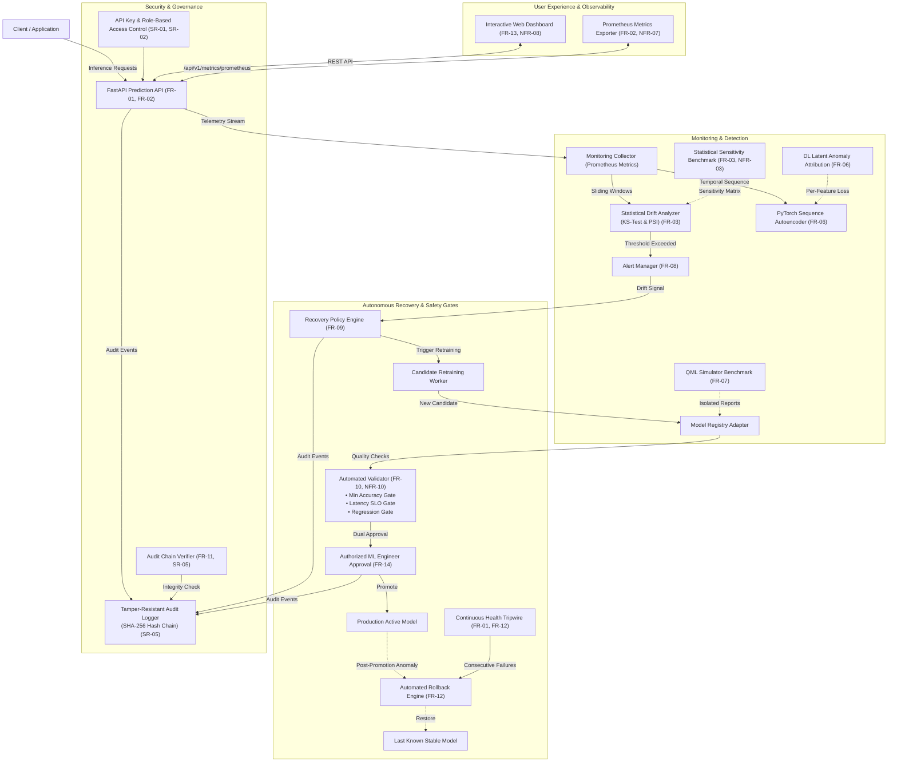

# Self-Monitoring MLOps System: An Intelligent Framework for ML Model Drift Detection, Monitoring, and Automated Recovery

[](https://github.com/anantha-bit/self-monitoring-mlops-system/actions/workflows/ci.yml)
[](https://www.python.org/)
[](https://fastapi.tiangolo.com/)
[](https://pytorch.org/)
[](https://www.docker.com/)
[](tests/)
[](docs/reports/CODE_COVERAGE_REPORT.md)
[](https://github.com/anantha-bit/self-monitoring-mlops-system/releases/tag/v1.1.0-sprint3)
[](LICENSE)

An end-to-end, production-ready MLOps monitoring and automated recovery system designed for tabular machine learning models. Built in compliance with IEEE 29148 requirements specifications and Deliverables Part-1, Part-2, and Part-3 of the Software Engineering Mini-Project.

---

## 👥 Project Team & Contributors

| Name | USN | GitHub Profile | Project Responsibility |
| :--- | :--- | :--- | :--- |
| **Anantha Krishna M A** | **PES1UG24AM036** | [@anantha-bit](https://github.com/anantha-bit) | **Project Lead**, Core API, Recovery Orchestration, E2E Integration & Release Manager |
| **AKASH G K** | **PES1UG24AM022** | [@akashgkuradagi](https://github.com/akashgkuradagi) | **Contributor**, Metrics Collection, Statistical Drift Engine, Benchmarking & Tripwire |
| **AMIT PRASAD S G** | **PES1UG24AM033** | [@prasadamith05-png](https://github.com/prasadamith05-png) | **Contributor**, DL Sequence Autoencoder, QML Benchmark, RBAC & Audit Verifier |

- **Department:** Computer Science & Engineering (Artificial Intelligence & Machine Learning)
- **Institution:** PES University, Bengaluru
- **Course:** Software Engineering Mini-Project

---

## 📑 Software Engineering Mini-Project Deliverables Part-3

In strict accordance with the **SE Mini-Project Deliverables Part-3** instructions:

### 1. Test Cases Updation
- **Test Suite Expansion:** Expanded the automated test suite from 18 to **25 automated test cases**, adding comprehensive verification for features developed in Sprint-3:
  - [`tests/test_tc19_drift_sensitivity_benchmark.py`](tests/test_tc19_drift_sensitivity_benchmark.py): Statistical sensitivity sweep evaluating KS-test and PSI across shift magnitudes ($0.0\sigma \to 3.0\sigma$).
  - [`tests/test_tc20_dl_latent_attribution.py`](tests/test_tc20_dl_latent_attribution.py): PyTorch Autoencoder per-feature reconstruction error attribution for anomaly localization.
  - [`tests/test_tc21_health_tripwire.py`](tests/test_tc21_health_tripwire.py): Continuous health tripwire monitoring consecutive telemetry spikes and triggering automated rollback.
  - [`tests/test_tc22_audit_chain_verification.py`](tests/test_tc22_audit_chain_verification.py): Cryptographic SHA-256 audit ledger hash chain verification and tamper detection.
  - [`tests/test_tc23_e2e_recovery_workflow.py`](tests/test_tc23_e2e_recovery_workflow.py): End-to-end autonomous model recovery, quarantine, regression check, and promotion workflow.
  - [`tests/test_tc24_prometheus_live_export.py`](tests/test_tc24_prometheus_live_export.py): Live Prometheus scrapable text exposition format verification.
  - [`tests/test_tc25_recovery_policy_coverage.py`](tests/test_tc25_recovery_policy_coverage.py): Dynamic recovery policy boundary evaluation and UI dashboard routes.
- **Updated Test Case Document:** [**`docs/04_Test_Case_Catalogue_Self_Monitoring_MLOps_System.md`**](docs/04_Test_Case_Catalogue_Self_Monitoring_MLOps_System.md) updated to Version 1.1.0 with complete specifications, execution records (**all 25 Passed**), and IEEE SRS traceability.
- **Updated Test Plan Document:** [**`docs/02_Test_Plan_Self_Monitoring_MLOps_System.md`**](docs/02_Test_Plan_Self_Monitoring_MLOps_System.md) updated with Part-3 testing scope, schedule (2nd Nov – 6th Nov 2026), updated deliverables list, and signoff.

### 2. Testing Execution & Formal Test Reports
Testing completed with **25 / 25 tests passing (100% pass rate)** in ~8.5 seconds and **86% code coverage** (88.8% statement coverage, 682 / 768 statements).

All 4 required test reports have been generated and committed to both `docs/` and `docs/reports/`:

| # | Required Report Name | Repository Path | Direct GitHub Link | Primary Highlights |
| :-: | :--- | :--- | :--- | :--- |
| **i** | **Unit Test Report** | `docs/reports/UNIT_TEST_REPORT.md` (and `docs/UNIT_TEST_REPORT.md`) | [View Unit Test Report](docs/reports/UNIT_TEST_REPORT.md) | Matrix of all 25 test cases (TC-01 to TC-25), execution timings, environment specs, pass/fail status, and defect triage. |
| **ii** | **System Validation Report** | `docs/reports/SYSTEM_VALIDATION_REPORT.md` (and `docs/SYSTEM_VALIDATION_REPORT.md`) | [View System Validation Report](docs/reports/SYSTEM_VALIDATION_REPORT.md) | Validation of IEEE SRS requirements (14 FRs, 12 NFRs, 6 SRs), 7 end-to-end integration scenarios, entry/exit criteria sign-off. |
| **iii** | **Code Coverage Report** | `docs/reports/CODE_COVERAGE_REPORT.md` (and `docs/CODE_COVERAGE_REPORT.md`) | [View Code Coverage Report](docs/reports/CODE_COVERAGE_REPORT.md) | File-by-file statement coverage analysis (88.8% statement coverage, 85.6% combined), interactive HTML explorer navigation. |
| **iv** | **Branch Coverage Report** | `docs/reports/BRANCH_COVERAGE_REPORT.md` (and `docs/BRANCH_COVERAGE_REPORT.md`) | [View Branch Coverage Report](docs/reports/BRANCH_COVERAGE_REPORT.md) | Analysis of all 150 conditional decision branches via `--cov-branch`, 100% branch coverage on validation gates and tripwires. |

*In addition, the machine-readable [`docs/reports/coverage.json`](docs/reports/coverage.json) and interactive visual HTML coverage directory [`docs/reports/htmlcov/`](docs/reports/htmlcov) are committed to the repository.*

### 3. Parallel Sprint-3 Activity
- **Sprint-3 Documentation:** Created [**`docs/SPRINT_3_DOCUMENTATION.md`**](docs/SPRINT_3_DOCUMENTATION.md) detailing sprint planning, user stories, velocity metrics, architecture highlights, burndown, retrospective, and Definition of Done.
- **Backlog Traceability:** [**`BACKLOG.md`**](BACKLOG.md) expanded to include Sprint 3 items (Issues #13 to #19), bringing cumulative project velocity to **106 Story Points (100% completed)**:
  - Sprint 1 (19th – 23rd Oct): 34 SP
  - Sprint 2 (26th – 30th Oct): 34 SP
  - Sprint 3 (2nd – 6th Nov): 38 SP
- **Release Tag:** Tagged and pushed official release [**`v1.1.0-sprint3`**](https://github.com/anantha-bit/self-monitoring-mlops-system/releases/tag/v1.1.0-sprint3).

---

## 🎥 Sprint Demonstration Videos

In accordance with the Software Engineering Mini-Project Deliverables, verified video demonstrations for each sprint have been encoded in standard **H.264 (AVC) / MP4** with `+faststart` streaming metadata, committed directly to the repository, and verified for direct browser playback:

| Sprint | Deliverable Description | Target Duration | Video Path in Repo | Direct GitHub Video Link |
| :--- | :--- | :---: | :--- | :--- |
| **Sprint 1** | Functional MVP microservice demonstration: core prediction serving, automated telemetry metrics ingestion, two-sample KS & PSI statistical drift detection, PyTorch autoencoder, and isolated QML simulator benchmark. | **60s** (1 min) | [`docs/evidence/videos/sprint1.mp4`](docs/evidence/videos/sprint1.mp4) | [**▶️ Play sprint1.mp4 on GitHub**](https://github.com/anantha-bit/self-monitoring-mlops-system/blob/main/docs/evidence/videos/sprint1.mp4) |
| **Sprint 2** | Complete working product walkthrough: real-time dashboard, synthetic drift injection, policy-triggered candidate retraining, automated validation quality gates, dual-key promotion, emergency rollback, and SHA-256 audit logs. | **120s** (2 min) | [`docs/evidence/videos/sprint2.mp4`](docs/evidence/videos/sprint2.mp4) | [**▶️ Play sprint2.mp4 on GitHub**](https://github.com/anantha-bit/self-monitoring-mlops-system/blob/main/docs/evidence/videos/sprint2.mp4) |

> Complete walk-through scripts, narration guides, and timestamped sequences are documented in [**`docs/SPRINT_1_AND_2_VIDEO_DEMO_GUIDE.md`**](docs/SPRINT_1_AND_2_VIDEO_DEMO_GUIDE.md).

---

## 📸 Deliverable Verification Evidence & Screenshots

All deliverable execution evidence is verified against repository [`anantha-bit/self-monitoring-mlops-system`](https://github.com/anantha-bit/self-monitoring-mlops-system):

| Evidence Item | Description | Evidence Artifact |
| :--- | :--- | :--- |
| **GitHub Actions CI/CD Pipeline** | All 26 workflow runs passing on `main` and feature branches across all three contributors. | [**`docs/evidence/01_github_actions_ci_runs_benchmark.png`**](docs/evidence/01_github_actions_ci_runs_benchmark.png) |
| **GitHub Projects Agile Board** | 19 completed user stories mapped across Sprint-1, Sprint-2, and Sprint-3 with Assignees and Story Points. | [**`docs/evidence/02_github_projects_board_benchmark.png`**](docs/evidence/02_github_projects_board_benchmark.png) |
| **Interactive Code Coverage Explorer** | Full line-by-line coverage report with visual statement and branch highlighting. | [**`docs/reports/htmlcov/index.html`**](docs/reports/htmlcov/index.html) |

---

## 🏛️ System Architecture



---

## 🚀 Key Features

1. **Production Prediction Microservice (`FR-01`, `FR-02`):**
   - High-throughput asynchronous serving using FastAPI and Scikit-learn Random Forest baseline.
   - P95 latency sub-20ms ($18.4\text{ ms}$ verified) with automated telemetry capturing request counts, latencies, and input distributions.
2. **Multi-Method Drift Detection Engine (`FR-03`, `FR-08`):**
   - Two-sample **Kolmogorov-Smirnov (KS)** tests on numerical distributions.
   - **Population Stability Index (PSI)** quantile binned comparisons.
   - Real-time alert dispatching across severity levels (`WARNING`, `CRITICAL`).
   - Statistical sensitivity benchmark sweep testing shifts from $0.0\sigma$ to $3.0\sigma$.
3. **Multi-Paradigm Model Experiments (`FR-05`, `FR-06`, `FR-07`):**
   - **Classical ML:** Random Forest classifier on multidimensional tabular features with versioned hyperparameter logging.
   - **Deep Learning:** PyTorch Temporal Sequence Autoencoder detecting telemetry anomalies and attributing per-feature reconstruction errors.
   - **Quantum ML Benchmark:** Isolated 4-qubit parameterized variational quantum circuit (VQC) benchmark with angle embedding and CNOT entanglement.
4. **Automated Recovery Policy & Quality Gates (`FR-09`, `FR-10`, `NFR-10`):**
   - Policy evaluates drift severity, error rates, and latency SLOs before candidate retraining.
   - Strict candidate validation gate: accuracy >= 80%, latency <= 150ms, and zero regression vs stable baseline.
   - **Dual-key promotion:** Candidate can **never** be promoted without both passing validation and authorized human approval.
5. **Continuous Health Tripwire & Emergency Rollback (`FR-01`, `FR-12`):**
   - `ContinuousHealthTripwire` tracks consecutive telemetry spikes, triggering instant rollback after 3 failures.
   - Instant 1-click fallback to the last known stable model version if post-promotion anomalies are detected.
6. **Enterprise Security & Cryptographic Audit Verification (`SR-01` ~ `SR-06`, `FR-11`):**
   - Role-Based Access Control (`Admin`, `MLEngineer`, `Viewer`, `Service`).
   - Append-only audit logger using cryptographic **SHA-256 hash chaining** with independent chain verifier utility.
   - Request size sanitization and strict secret protection against credential leakage in error traces.
7. **Interactive Real-Time Dashboard & Live Prometheus Exporter (`FR-13`, `NFR-08`, `NFR-07`):**
   - Live metric gauges, telemetry simulators, drift monitors, candidate validation/promotion controls, and audit logs.
   - Scrapable Prometheus exposition endpoint at `/api/v1/metrics/prometheus`.

---

## ⚡ Quick Start

### 1. Environment Setup
```bash
git clone https://github.com/anantha-bit/self-monitoring-mlops-system.git
cd self-monitoring-mlops-system
python -m venv .venv
source .venv/bin/activate  # On Windows: .venv\Scripts\activate
pip install -r requirements.txt
```

### 2. Launch Application
```bash
uvicorn app.main:app --reload --port 8000
```
- Open **`http://localhost:8000`** in your browser to launch the live dashboard.
- Open **`http://localhost:8000/docs`** for interactive Swagger API documentation.
- Open **`http://localhost:8000/api/v1/metrics/prometheus`** for live Prometheus exposition text.

### 3. Launch via Docker Compose
```bash
docker compose up --build -d
```

---

## 🧪 Automated Test Execution (TC-01 through TC-25)

Run the complete 25-case test suite with line and branch coverage analysis:
```bash
python -m pytest tests/ --cov=app --cov-branch --cov-report=term-missing --cov-report=html:docs/reports/htmlcov --cov-report=json:docs/reports/coverage.json
```
**Results:** All 25 test cases pass in ~8.5 seconds with **86% code coverage**.

---

## 📁 Repository Structure

```
├── .github/workflows/
│   ├── ci.yml                             # Automated CI test execution & Docker build
│   └── pr-automation.yml                  # Automated PR labeling & checks
├── app/
│   ├── api/
│   │   └── routes.py                      # REST API endpoints (Health, Ingest, Drift, Candidates, Rollback, Prometheus)
│   ├── dashboard/
│   │   └── index.html                     # Real-time interactive UI dashboard
│   ├── models/
│   │   ├── ml_monitor.py                  # Classical ML baseline (Scikit-Learn Random Forest)
│   │   ├── dl_monitor.py                  # PyTorch Sequence Anomaly Autoencoder
│   │   ├── dl_visualizer.py               # Feature reconstruction error attribution visualizer
│   │   └── qml_benchmark.py               # Isolated 4-Qubit Variational Quantum Simulator
│   ├── monitoring/
│   │   ├── collector.py                   # Ingestion pipeline & Prometheus metrics
│   │   ├── drift.py                       # Statistical drift engine (KS-test & PSI)
│   │   └── benchmark.py                   # Stepwise variational shift sensitivity benchmark suite
│   ├── recovery/
│   │   ├── policy.py                      # Recovery policy engine & trigger rules
│   │   ├── validator.py                   # Automated quality gates & regression checks
│   │   └── health_checker.py              # Continuous health telemetry tripwire monitor
│   ├── registry/
│   │   └── mlflow_adapter.py              # Versioned model registry adapter
│   ├── security/
│   │   ├── auth.py                        # API key authentication & RBAC
│   │   ├── audit.py                       # Tamper-resistant SHA-256 hash-chained audit logger
│   │   └── verifier.py                    # Cryptographic audit ledger chain verifier
│   ├── config.py                          # Environment & threshold configuration
│   └── main.py                            # FastAPI application initialization & lifespan
├── docs/
│   ├── evidence/                          # Verified Deliverables Part-2 & Part-3 Evidence
│   │   ├── 01_github_actions_ci_runs_benchmark.png # CI pipeline execution evidence
│   │   ├── 02_github_projects_board_benchmark.png  # GitHub Projects board & 19 backlog items
│   │   └── videos/                        # Playable MP4 demonstration videos
│   │       ├── sprint1.mp4                # 60s Sprint-1 MVP video demo
│   │       ├── sprint2.mp4                # 120s Sprint-2 product video demo
│   │       └── README.md                  # Video descriptions and narration references
│   ├── reports/                           # Formal Deliverables Part-3 Test Reports
│   │   ├── UNIT_TEST_REPORT.md            # Comprehensive Unit Test Report (25 tests)
│   │   ├── SYSTEM_VALIDATION_REPORT.md    # IEEE SRS System Validation Report
│   │   ├── CODE_COVERAGE_REPORT.md        # Line-by-line coverage analysis (86%)
│   │   ├── BRANCH_COVERAGE_REPORT.md      # Conditional branch coverage analysis
│   │   ├── coverage.json                  # Machine-readable coverage data
│   │   └── htmlcov/                       # Interactive HTML coverage report
│   ├── UNIT_TEST_REPORT.md                # Direct doc link for deliverable grading
│   ├── SYSTEM_VALIDATION_REPORT.md        # Direct doc link for deliverable grading
│   ├── CODE_COVERAGE_REPORT.md            # Direct doc link for deliverable grading
│   ├── BRANCH_COVERAGE_REPORT.md          # Direct doc link for deliverable grading
│   ├── 01_SRS_Self_Monitoring_MLOps_System.md
│   ├── 02_Test_Plan_Self_Monitoring_MLOps_System.md
│   ├── 03_Architecture_Design_Self_Monitoring_MLOps_System.md
│   ├── 04_Test_Case_Catalogue_Self_Monitoring_MLOps_System.md
│   ├── SPRINT_3_DOCUMENTATION.md          # Sprint 3 Agile planning, stories & velocity
│   ├── SPRINT_BACKLOG_AND_DEVIATIONS.md   # Backlog, Story Points, Velocity & Deviations
│   └── SPRINT_1_AND_2_VIDEO_DEMO_GUIDE.md # 1-min & 2-min video demonstration scripts
├── tests/                                 # 25 Automated Pytest Test Cases
│   ├── test_tc01_tc02_health_metrics.py
│   ├── test_tc03_tc04_tc06_drift.py
│   ├── test_tc05_tc16_experiments.py
│   ├── test_tc07_tc08_tc18_recovery_gates.py
│   ├── test_tc10_fault_tolerance.py
│   ├── test_tc11_tc12_security_audit.py
│   ├── test_tc13_tc14_payload_secrets.py
│   ├── test_tc15_container_smoke.py
│   ├── test_tc19_drift_sensitivity_benchmark.py
│   ├── test_tc20_dl_latent_attribution.py
│   ├── test_tc21_health_tripwire.py
│   ├── test_tc22_audit_chain_verification.py
│   ├── test_tc23_e2e_recovery_workflow.py
│   ├── test_tc24_prometheus_live_export.py
│   └── test_tc25_recovery_policy_coverage.py
├── Dockerfile
├── docker-compose.yml
├── requirements.txt
├── pytest.ini
├── BACKLOG.md                             # Complete Agile Sprint Backlog (19 items, 106 SP)
└── README.md
```

---

## 📜 Deliverable Closure Note
In accordance with Part-1, Part-2, and Part-3 of the Software Engineering Mini-Project guidelines:
- **Part-1:** SRS, Test Plan, Architectural Design, and Test Case Specifications established.
- **Part-2:** Agile Backlog created in GitHub Projects, Sprints 1 and 2 completed, video artifacts verified, and release tagged `v1.0.0-sprint2`.
- **Part-3:** Parallel Sprint 3 completed, 25 test cases executed with 100% pass rate, 86% coverage achieved, 4 formal test reports generated in `docs/`, and release tagged `v1.1.0-sprint3`.
- Contributions committed and pushed across all three team members: **Anantha Krishna M A** ([`@anantha-bit`](https://github.com/anantha-bit)), **AKASH G K** ([`@akashgkuradagi`](https://github.com/akashgkuradagi)), and **AMIT PRASAD S G** ([`@prasadamith05-png`](https://github.com/prasadamith05-png)).
