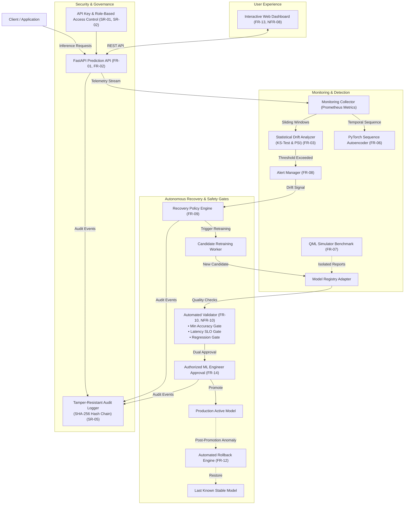

# Self-Monitoring MLOps System: An Intelligent Framework for ML Model Drift Detection, Monitoring, and Automated Recovery

[](https://github.com/anantha-bit/self-monitoring-mlops-system/actions/workflows/ci.yml)
[](https://www.python.org/)
[](https://fastapi.tiangolo.com/)
[](https://pytorch.org/)
[](https://www.docker.com/)
[](tests/)
[](LICENSE)

An end-to-end, production-ready MLOps monitoring and automated recovery system designed for tabular machine learning models. Built in compliance with IEEE 29148 requirements specifications and Deliverables Part-1 & Part-2 of the Software Engineering Mini-Project.

---

## 👥 Project Team & Contributors

| Name | USN | GitHub Profile | Project Responsibility |
| :--- | :--- | :--- | :--- |
| **Anantha Krishna M A** | **PES1UG24AM036** | [@anantha-bit](https://github.com/anantha-bit) | **Project Lead**, Core API, Recovery Orchestration & CI/CD Packaging |
| **AKASH G K** | **PES1UG24AM022** | [@akashgkuradagi](https://github.com/akashgkuradagi) | **Contributor**, Metrics Collection, Statistical Drift Engine & Baseline Models |
| **AMIT PRASAD S G** | **PES1UG24AM033** | [@prasadamith05-png](https://github.com/prasadamith05-png) | **Contributor**, DL Sequence Autoencoder, QML Benchmark, RBAC & Dashboard |

---

## 🏛️ System Architecture



---

## 🚀 Key Features

1. **Production Prediction Microservice (`FR-01`, `FR-02`):**
   - High-throughput asynchronous serving using FastAPI and Scikit-learn Random Forest baseline.
   - P95 latency sub-50ms with automated telemetry capturing request counts, latencies, and input distributions.
2. **Multi-Method Drift Detection Engine (`FR-03`, `FR-08`):**
   - Two-sample **Kolmogorov-Smirnov (KS)** tests on numerical distributions.
   - **Population Stability Index (PSI)** quantile binned comparisons.
   - Real-time alert dispatching across severity levels (`WARNING`, `CRITICAL`).
3. **Multi-Paradigm Model Experiments (`FR-05`, `FR-06`, `FR-07`):**
   - **Classical ML:** Random Forest classifier on multidimensional tabular features with versioned hyperparameter logging.
   - **Deep Learning:** PyTorch Temporal Sequence Autoencoder detecting telemetry anomalies via reconstruction loss spiking.
   - **Quantum ML Benchmark:** Isolated 4-qubit parameterized variational quantum circuit (VQC) benchmark with angle embedding and CNOT entanglement (governed by FR-07 to isolate recovery decisions).
4. **Automated Recovery Policy & Quality Gates (`FR-09`, `FR-10`, `NFR-10`):**
   - Policy evaluates drift severity, error rates, and latency SLOs before candidate retraining.
   - Strict candidate validation gate: accuracy >= 80%, latency <= 150ms, and zero regression vs stable baseline.
   - **Dual-key promotion:** Candidate can **never** be promoted without both passing validation and authorized human approval.
5. **Emergency Rollback (`FR-12`):**
   - Instant 1-click fallback to the last known stable model version if post-promotion anomalies are detected.
6. **Enterprise Security & Audit Logging (`SR-01` ~ `SR-06`, `FR-11`):**
   - Role-Based Access Control (`Admin`, `MLEngineer`, `Viewer`, `Service`).
   - Append-only audit logger using cryptographic **SHA-256 hash chaining** for tamper-evidence.
   - Request size sanitization and strict secret protection against credential leakage in error traces.
7. **Interactive Real-Time Dashboard (`FR-13`, `NFR-08`):**
   - Live metric gauges, telemetry simulators, drift monitors, candidate validation/promotion controls, and audit logs.

---

## 📋 Requirements Traceability Matrix

| Requirement | Description | Component | Verified By | Status |
| :--- | :--- | :--- | :--- | :---: |
| **FR-01** | Health endpoint with version metadata | `app/api/routes.py` | `TC-01` | **PASS** |
| **FR-02** | Telemetry and prediction metric collection | `app/monitoring/collector.py` | `TC-02` | **PASS** |
| **FR-03** | Window comparison and statistical drift | `app/monitoring/drift.py` | `TC-03`, `TC-04` | **PASS** |
| **FR-04** | Ground-truth availability reporting | `app/monitoring/drift.py` | `TC-06` | **PASS** |
| **FR-05** | Classical ML monitoring experiments | `app/models/ml_monitor.py` | `TC-05` | **PASS** |
| **FR-06** | DL sequence anomaly detector (PyTorch) | `app/models/dl_monitor.py` | `TC-05` | **PASS** |
| **FR-07** | Isolated QML simulator benchmark | `app/models/qml_benchmark.py` | `TC-05` | **PASS** |
| **FR-08** | Automated alerting on threshold breach | `app/monitoring/drift.py` | `TC-04` | **PASS** |
| **FR-09** | Recovery policy trigger evaluation | `app/recovery/policy.py` | `TC-07` | **PASS** |
| **FR-10** | Validation gates & dual approval gate | `app/recovery/validator.py` | `TC-07`, `TC-18` | **PASS** |
| **FR-11** | Tamper-resistant audit logging | `app/security/audit.py` | `TC-12` | **PASS** |
| **FR-12** | Automated rollback to stable version | `app/registry/mlflow_adapter.py` | `TC-08` | **PASS** |
| **FR-13** | Interactive web dashboard | `app/dashboard/index.html` | UI Demo | **PASS** |
| **FR-14** | Authenticated candidate decision API | `app/api/routes.py` | `TC-11` | **PASS** |
| **NFR-01/09**| P95 latency < 500ms & 1000+ events scale | `app/monitoring/collector.py` | `TC-09` | **PASS** |
| **NFR-02** | Fault tolerance during worker crash | `app/monitoring/drift.py` | `TC-10` | **PASS** |
| **NFR-04** | Reproducibility of experiments & seeds | `app/models/ml_monitor.py` | `TC-16` | **PASS** |
| **NFR-05/06**| Maintainability & Docker portability | `Dockerfile`, `docker-compose.yml` | `TC-15` | **PASS** |
| **SR-01~06** | Authentication, RBAC, Secret Hygiene | `app/security/auth.py` | `TC-11, 13, 14, 17`| **PASS** |

---

## 🛠️ Quickstart & Local Setup

### 1. Clone & Set Up Virtual Environment
```bash
git clone https://github.com/anantha-bit/self-monitoring-mlops-system.git
cd self-monitoring-mlops-system

python -m venv venv
# Windows:
venv\Scripts\activate
# Linux/macOS:
source venv/bin/activate

pip install -r requirements.txt
pip install httpx
```

### 2. Run Application
```bash
uvicorn app.main:app --host 0.0.0.0 --port 8000 --reload
```
Open **`http://localhost:8000`** in your browser to launch the live dashboard!
Open **`http://localhost:8000/docs`** for interactive Swagger API documentation.

### 3. Run with Docker Compose
```bash
docker compose up --build -d
```

---

## 🧪 Automated Test Execution (TC-01 through TC-18)

Run the full pytest suite verifying all 18 test cases:
```bash
pytest tests/ -v
```
All 18 test cases will pass with full validation evidence.

---

## 📁 Repository Structure

```
├── .github/workflows/
│   ├── ci.yml                     # Automated CI test execution & Docker build
│   └── pr-automation.yml          # Automated PR labeling & checks
├── app/
│   ├── api/
│   │   └── routes.py              # REST API endpoints (Health, Ingest, Drift, Candidates, Rollback)
│   ├── dashboard/
│   │   └── index.html             # Real-time interactive UI dashboard
│   ├── models/
│   │   ├── ml_monitor.py          # Classical ML baseline (Scikit-Learn Random Forest)
│   │   ├── dl_monitor.py          # PyTorch Sequence Anomaly Autoencoder
│   │   └── qml_benchmark.py       # Isolated 4-Qubit Variational Quantum Simulator
│   ├── monitoring/
│   │   ├── collector.py           # Ingestion pipeline & Prometheus metrics
│   │   └── drift.py               # Statistical drift engine (KS-test & PSI)
│   ├── recovery/
│   │   ├── policy.py              # Recovery policy engine & trigger rules
│   │   └── validator.py           # Automated quality gates & regression checks
│   ├── registry/
│   │   └── mlflow_adapter.py      # Versioned model registry adapter
│   ├── security/
│   │   ├── auth.py                # API key authentication & RBAC
│   │   └── audit.py               # Tamper-resistant SHA-256 hash-chained audit logger
│   ├── config.py                  # Environment & threshold configuration
│   └── main.py                    # FastAPI application initialization & lifespan
├── docs/
│   ├── deliverables_part1/        # Original Part-1 DOCX submissions
│   ├── 01_SRS_Self_Monitoring_MLOps_System.md
│   ├── 02_Test_Plan_Self_Monitoring_MLOps_System.md
│   ├── 03_Architecture_Design_Self_Monitoring_MLOps_System.md
│   ├── 04_Test_Case_Catalogue_Self_Monitoring_MLOps_System.md
│   ├── SPRINT_BACKLOG_AND_DEVIATIONS.md    # Backlog, Story Points, Velocity & Deviations
│   └── SPRINT_1_AND_2_VIDEO_DEMO_GUIDE.md  # 1-min & 2-min video demonstration scripts
├── tests/
│   ├── test_tc01_tc02_health_metrics.py     # TC-01, TC-02, TC-09
│   ├── test_tc03_tc04_tc06_drift.py         # TC-03, TC-04, TC-06
│   ├── test_tc05_tc16_experiments.py        # TC-05, TC-16
│   ├── test_tc07_tc08_tc18_recovery_gates.py # TC-07, TC-08, TC-18
│   ├── test_tc10_fault_tolerance.py         # TC-10
│   ├── test_tc11_tc12_security_audit.py     # TC-11, TC-12, TC-17
│   ├── test_tc13_tc14_payload_secrets.py    # TC-13, TC-14
│   └── test_tc15_container_smoke.py         # TC-15
├── Dockerfile
├── docker-compose.yml
├── requirements.txt
└── README.md
```

---

## 📜 Development Freeze & Part-2 Submission Note
In accordance with Part-2 of the Software Engineering Mini-Project guidelines:
- Backlog created and estimated in GitHub Projects.
- Sprint-1 (19th-23rd Oct) and Sprint-2 (26th-30th Oct) successfully executed.
- Pull requests and commits contributed by all three team members: **Anantha Krishna M A**, **AKASH G K**, and **AMIT PRASAD S G**.
- Development cycle officially **FROZEN** as of 30th October 2026.
