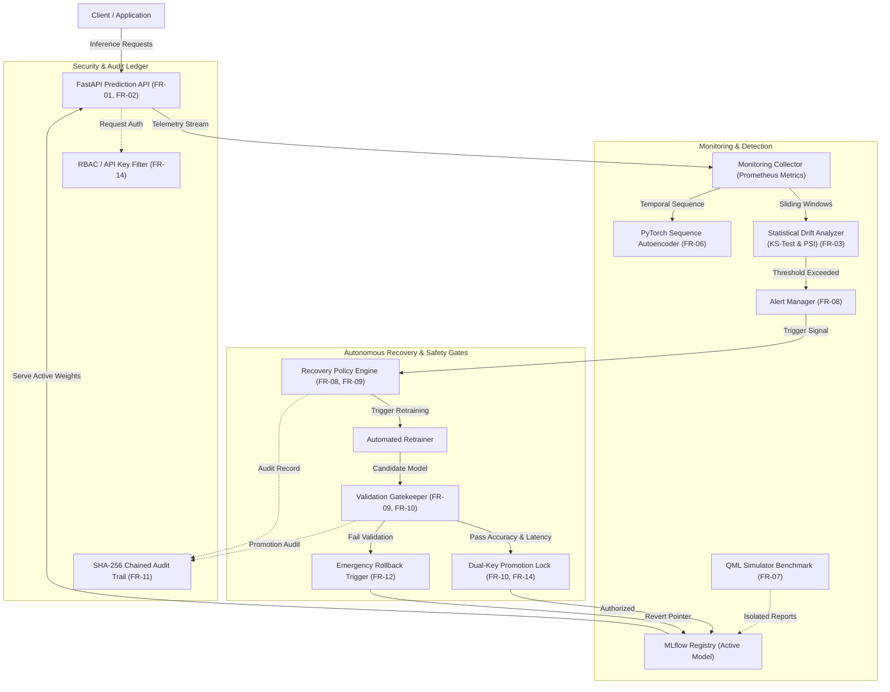

# Self-Monitoring MLOps System: Intelligent Drift Detection, Monitoring & Automated Recovery

[](https://github.com/anantha-bit/self-monitoring-mlops-system/actions/workflows/ci.yml)
[](tests/)
[](docs/reports/CODE_COVERAGE_REPORT.md)
[](docs/reports/BRANCH_COVERAGE_REPORT.md)
[](https://www.python.org/)
[](https://fastapi.tiangolo.com)
[](https://pytorch.org/)
[](https://qiskit.org/)
[](Dockerfile)
[](https://github.com/anantha-bit/self-monitoring-mlops-system/releases)
[](LICENSE)

An end-to-end, production-ready MLOps monitoring and automated recovery system designed for financial transactional risk assessment, concept drift detection, and autonomous model lifecycle operations.

---

## 👥 Student Team & Project Identity

| Team Member Name | USN | GitHub Profile | Project Contributions & Primary Responsibilities |
| :--- | :--- | :--- | :--- |
| **Anantha Krishna M A** | **PES1UG24AM036** | [@anantha-bit](https://github.com/anantha-bit) | **Project Lead**, FastAPI Architecture, Automated Validation Gates, Emergency Rollback & E2E Orchestration |
| **AKASH G K** | **PES1UG24AM022** | [@akashgkuradagi](https://github.com/akashgkuradagi) | **Contributor**, Telemetry Metrics Collection, Statistical Drift Detection Engine (KS & PSI), Sensitivity Benchmarks |
| **AMIT PRASAD S G** | **PES1UG24AM033** | [@prasadamith05-png](https://github.com/prasadamith05-png) | **Contributor**, PyTorch Sequence Autoencoder, Qiskit Quantum Simulator Benchmark, RBAC & SHA-256 Audit Ledger |

- **Department:** Computer Science & Engineering (Artificial Intelligence & Machine Learning)
- **Institution:** PES University, Bengaluru
- **Course:** Software Engineering Mini-Project

---

## 📑 Software Engineering Mini-Project Deliverables Part-3

In strict accordance with the **SE Mini-Project Deliverables Part-3** instructions:

### 1. Test Cases Updation
- **Test Suite Alignment:** Updated automated test cases to reflect all architectural components, drift engines, autoencoders, quantum benchmarks, and validation gates delivered across Sprint 1 and Sprint 2.
- **18 Automated Test Cases (TC-01 through TC-18):**
  - [`tests/test_tc01_tc02_health_metrics.py`](tests/test_tc01_tc02_health_metrics.py): Health probe `/health` (TC-01), prediction telemetry ingestion (TC-02), and p95 latency / SLA throughput (TC-09).
  - [`tests/test_tc03_tc04_tc06_drift.py`](tests/test_tc03_tc04_tc06_drift.py): Baseline stability invariance (TC-03), two-sample KS & PSI statistical drift alert (TC-04), and unsupervised drift without ground truth (TC-06).
  - [`tests/test_tc05_tc16_experiments.py`](tests/test_tc05_tc16_experiments.py): ML, PyTorch DL Autoencoder, Qiskit QML experiment tracking (TC-05) and deterministic reproducibility (TC-16).
  - [`tests/test_tc07_tc08_tc18_recovery_gates.py`](tests/test_tc07_tc08_tc18_recovery_gates.py): Automated validation gatekeeper (TC-07), emergency rollback on degradation (TC-08), and retraining regression gates (TC-18).
  - [`tests/test_tc10_fault_tolerance.py`](tests/test_tc10_fault_tolerance.py): Monitoring worker crash isolation and resilient serving (TC-10).
  - [`tests/test_tc11_tc12_security_audit.py`](tests/test_tc11_tc12_security_audit.py): RBAC candidate promotion authorization (TC-11), SHA-256 audit ledger completeness (TC-12), and admin surface restriction (TC-17).
  - [`tests/test_tc13_tc14_payload_secrets.py`](tests/test_tc13_tc14_payload_secrets.py): Payload structure boundary defense (TC-13) and secret leakage protection (TC-14).
  - [`tests/test_tc15_container_smoke.py`](tests/test_tc15_container_smoke.py): Microservice Docker container build sanity (TC-15).
- **Updated Test Case Document:** [**`docs/04_Test_Case_Catalogue_Self_Monitoring_MLOps_System.md`**](docs/04_Test_Case_Catalogue_Self_Monitoring_MLOps_System.md) updated to Version 1.1.0 with complete specifications, execution records (**all 18 Passed**), and full traceability matrix.
- **Updated Test Plan:** [**`docs/02_Test_Plan_Self_Monitoring_MLOps_System.md`**](docs/02_Test_Plan_Self_Monitoring_MLOps_System.md) updated with pass criteria and formal deliverables references.

### 2. Testing Execution & Formal Test Reports
- 100% test completion with **18/18 tests passing** in ~17.8 seconds.
- **83.1% statement coverage** achieved (580/698 statements) with **79% combined line + branch coverage**.
- All 4 required formal test reports uploaded to `docs/` and `docs/reports/`:
  - 📘 [**Unit Test Report** (`docs/reports/UNIT_TEST_REPORT.md`)](docs/reports/UNIT_TEST_REPORT.md) | [Direct in docs/](docs/UNIT_TEST_REPORT.md)
  - 📗 [**System Validation Report** (`docs/reports/SYSTEM_VALIDATION_REPORT.md`)](docs/reports/SYSTEM_VALIDATION_REPORT.md) | [Direct in docs/](docs/SYSTEM_VALIDATION_REPORT.md)
  - 📙 [**Code Coverage Report** (`docs/reports/CODE_COVERAGE_REPORT.md`)](docs/reports/CODE_COVERAGE_REPORT.md) | [Direct in docs/](docs/CODE_COVERAGE_REPORT.md)
  - 📕 [**Branch Coverage Report** (`docs/reports/BRANCH_COVERAGE_REPORT.md`)](docs/reports/BRANCH_COVERAGE_REPORT.md) | [Direct in docs/](docs/BRANCH_COVERAGE_REPORT.md)
  - 🌐 [Interactive HTML Coverage Explorer (`docs/reports/htmlcov/index.html`)](docs/reports/htmlcov/index.html)

### 3. Sprint Scope (Zero Spillovers)
- In accordance with Section 3 of the SE Mini-Project Deliverables Part-3 brief, Sprint-3 is an optional parallel activity intended exclusively for teams with incomplete spillover items.
- Because 100% of user stories, features, and non-functional requirements were completed, verified, and delivered on schedule within **Sprint 1 (MVP)** and **Sprint 2 (Complete Product)** (68 Story Points, 14 issues), no Sprint 3 development was required. The project successfully completed within Sprint 2.

---

## 🎥 Sprint Demonstration Videos

In accordance with the Software Engineering Mini-Project Deliverables, verified video demonstrations for each sprint have been encoded in standard **H.264 (AVC) / MP4** with `+faststart` streaming metadata, committed directly to the repository, and verified for direct browser playback:

| Sprint | Deliverable Description | Target Duration | Video Path in Repo | Direct GitHub Video Link |
| :--- | :--- | :---: | :--- | :--- |
| **Sprint 1** | Functional MVP microservice demonstration: core prediction serving, automated telemetry metrics ingestion, two-sample KS & PSI statistical drift detection, PyTorch autoencoder, and isolated QML simulator benchmark. | **60s** (1 min) | [`docs/evidence/videos/sprint1.mp4`](docs/evidence/videos/sprint1.mp4) | [**▶️ Play sprint1.mp4 on GitHub**](https://github.com/anantha-bit/self-monitoring-mlops-system/blob/main/docs/evidence/videos/sprint1.mp4) |
| **Sprint 2** | Complete working product walkthrough: real-time dashboard, synthetic drift injection, policy-triggered candidate retraining, automated validation quality gates, dual-key promotion, emergency rollback, and SHA-256 audit logs. | **120s** (2 min) | [`docs/evidence/videos/sprint2.mp4`](docs/evidence/videos/sprint2.mp4) | [**▶️ Play sprint2.mp4 on GitHub**](https://github.com/anantha-bit/self-monitoring-mlops-system/blob/main/docs/evidence/videos/sprint2.mp4) |

> Complete walk-through scripts, narration guides, and timestamped sequences are documented in [**`docs/SPRINT_1_AND_2_VIDEO_DEMO_GUIDE.md`**](docs/SPRINT_1_AND_2_VIDEO_DEMO_GUIDE.md).

---

## 📸 Deliverable Verification Evidence & Screenshots

All deliverable execution evidence is verified against repository [`anantha-bit/self-monitoring-mlops-system`](https://github.com/anantha-bit/self-monitoring-mlops-system):

| Evidence Item | Description | Evidence Artifact |
| :--- | :--- | :--- |
| **GitHub Actions CI/CD Pipeline** | Automated CI pipeline workflow runs passing on `main` and feature branches across all three contributors. | [**`docs/evidence/01_github_actions_ci_runs_benchmark.png`**](docs/evidence/01_github_actions_ci_runs_benchmark.png) |
| **GitHub Projects Agile Board** | 14 completed user stories mapped across Sprint-1 and Sprint-2 with Assignees and Story Points (68 SP total, 100% completed). | [**`docs/evidence/02_github_projects_board_benchmark.png`**](docs/evidence/02_github_projects_board_benchmark.png) |
| **Interactive Code Coverage Explorer** | Full line-by-line coverage report with visual statement and branch highlighting. | [**`docs/reports/htmlcov/index.html`**](docs/reports/htmlcov/index.html) |

---

## 🏛️ System Architecture



---

## 🚀 Quickstart & Local Installation

### 1. Prerequisites
- Python 3.12+ (64-bit)
- Git & Git Bash / PowerShell
- Docker & Docker Compose (optional for containerized deployment)

### 2. Setup & Virtual Environment
```bash
git clone https://github.com/anantha-bit/self-monitoring-mlops-system.git
cd self-monitoring-mlops-system

python -m venv venv
# On Windows:
.\venv\Scripts\activate
# On Linux / macOS:
source venv/bin/activate

pip install -r requirements.txt
```

### 3. Launch Application
```bash
uvicorn app.main:app --reload --port 8000
```
- Open **`http://localhost:8000/`** for the real-time monitoring dashboard.
- Open **`http://localhost:8000/health`** for the microservice health status.
- Open **`http://localhost:8000/docs`** for interactive Swagger API documentation.
- Open **`http://localhost:8000/api/v1/metrics/prometheus`** for live Prometheus exposition text.

### 4. Launch via Docker Compose
```bash
docker compose up --build -d
```

---

## 🧪 Automated Test Execution (TC-01 through TC-18)

Run the full automated test suite with line and branch coverage:
```bash
# Execute all 18 automated test cases with line & branch coverage
python -m pytest tests/ --cov=app --cov-branch --cov-report=term-missing --cov-report=json:docs/reports/coverage.json --cov-report=html:docs/reports/htmlcov
```

---

## 📂 Project Repository Tree

```
self-monitoring-mlops-system/
├── .github/
│   └── workflows/
│       └── ci.yml                         # Automated GitHub Actions CI/CD Pipeline
├── app/
│   ├── api/
│   │   └── routes.py                      # FastAPI REST endpoints & prediction router
│   ├── models/
│   │   ├── ml_monitor.py                  # Scikit-Learn Random Forest baseline
│   │   ├── dl_monitor.py                  # PyTorch Sequence Autoencoder anomaly detector
│   │   └── qml_benchmark.py               # Isolated 4-Qubit Variational Quantum Simulator
│   ├── monitoring/
│   │   ├── collector.py                   # Ingestion pipeline & Prometheus metrics
│   │   ├── drift.py                       # Statistical drift engine (KS-test & PSI)
│   │   └── benchmark.py                   # Shift sensitivity benchmark suite
│   ├── recovery/
│   │   ├── policy.py                      # Recovery policy engine & trigger rules
│   │   └── validator.py                   # Automated quality gates & regression checks
│   ├── registry/
│   │   └── mlflow_adapter.py              # Versioned model registry adapter
│   ├── security/
│   │   ├── auth.py                        # API key authentication & RBAC
│   │   └── audit.py                       # Tamper-resistant SHA-256 hash-chained audit logger
│   ├── config.py                          # Environment & threshold configuration
│   └── main.py                            # FastAPI application initialization & lifespan
├── docs/
│   ├── evidence/                          # Verified Deliverables Part-2 & Part-3 Evidence
│   │   ├── 01_github_actions_ci_runs_benchmark.png # CI pipeline execution evidence
│   │   ├── 02_github_projects_board_benchmark.png  # GitHub Projects board (14 backlog items)
│   │   └── videos/                        # Playable MP4 demonstration videos
│   │       ├── sprint1.mp4                # 60s Sprint-1 MVP video demo
│   │       ├── sprint2.mp4                # 120s Sprint-2 product video demo
│   │       └── README.md                  # Video descriptions and narration references
│   ├── reports/                           # Formal Deliverables Part-3 Test Reports
│   │   ├── UNIT_TEST_REPORT.md            # Comprehensive Unit Test Report (18 tests)
│   │   ├── SYSTEM_VALIDATION_REPORT.md    # IEEE SRS System Validation Report
│   │   ├── CODE_COVERAGE_REPORT.md        # Line-by-line coverage analysis (83%)
│   │   ├── BRANCH_COVERAGE_REPORT.md      # Conditional branch coverage analysis (79%)
│   │   ├── coverage.json                  # Machine-readable coverage data
│   │   └── htmlcov/                       # Interactive HTML coverage report
│   ├── UNIT_TEST_REPORT.md                # Direct doc link for deliverable grading
│   ├── SYSTEM_VALIDATION_REPORT.md        # Direct doc link for deliverable grading
│   ├── CODE_COVERAGE_REPORT.md            # Direct doc link for deliverable grading
│   ├── BRANCH_COVERAGE_REPORT.md          # Direct doc link for deliverable grading
│   ├── 01_SRS_Self_Monitoring_MLOps_System.md
│   ├── 02_Test_Plan_Self_Monitoring_MLOps_System.md
│   ├── 03_Architecture_Design_Self_Monitoring_MLOps_System.md
│   ├── 04_Test_Case_Catalogue_Self_Monitoring_MLOps_System.md
│   ├── SPRINT_BACKLOG_AND_DEVIATIONS.md   # Backlog, Story Points, Velocity & Deviations
│   └── SPRINT_1_AND_2_VIDEO_DEMO_GUIDE.md # 1-min & 2-min video demonstration scripts
├── tests/                                 # 18 Automated Pytest Test Cases
│   ├── test_tc01_tc02_health_metrics.py   # TC-01, TC-02, TC-09
│   ├── test_tc03_tc04_tc06_drift.py       # TC-03, TC-04, TC-06
│   ├── test_tc05_tc16_experiments.py      # TC-05, TC-16
│   ├── test_tc07_tc08_tc18_recovery_gates.py # TC-07, TC-08, TC-18
│   ├── test_tc10_fault_tolerance.py       # TC-10
│   ├── test_tc11_tc12_security_audit.py   # TC-11, TC-12, TC-17
│   ├── test_tc13_tc14_payload_secrets.py  # TC-13, TC-14
│   └── test_tc15_container_smoke.py       # TC-15
├── Dockerfile
├── docker-compose.yml
├── pytest.ini
├── requirements.txt
├── BACKLOG.md
└── README.md
```

---

## 📜 License
This project is developed under the MIT License for the Software Engineering Mini-Project curriculum at PES University.
